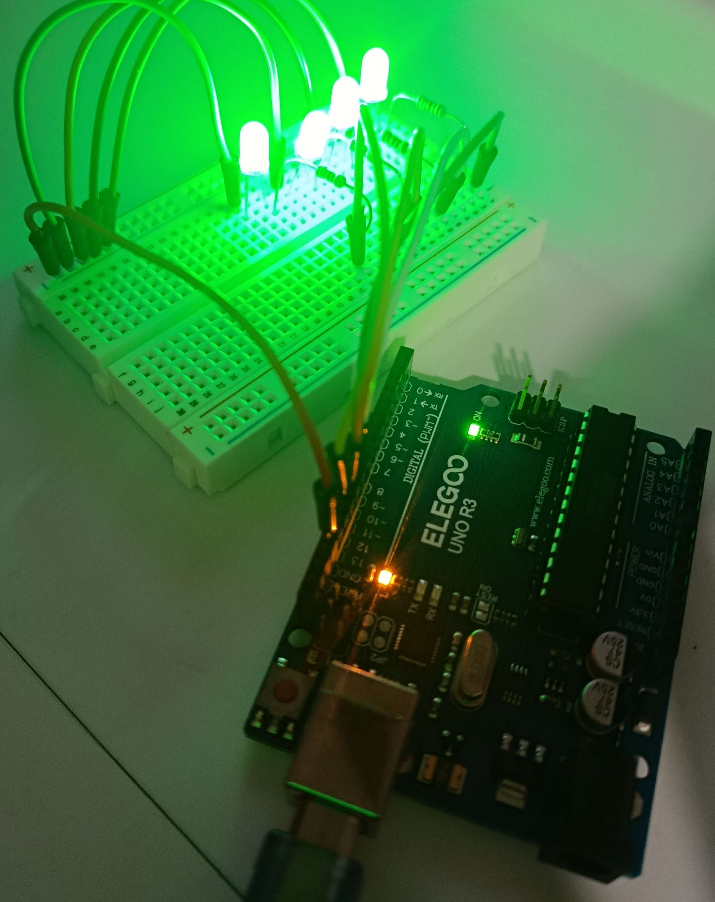

# Arduino Learning

This repository is where I experiment with Arduino, learning the fundamentals of working with hardware and build things to understand how they work in practice.
I'm using Git history to document the process, so jump to any of the documented commits (or a random one, whatever floats your boat) to check how it was implemented.

[_Explore the commit history_](https://github.com/ph0nsy/Arduino-Learning/commits/main)

## Projects

### 1. Binary counter

_[View Commit](https://github.com/ph0nsy/Arduino-Learning/tree/c3ec58170c44292dec32c15b78eebdbdbf204bd0)_

A first step into digital outputs and representing numbers (up to 4 bits) using LEDs.

||
|:---:|
||
| Picture of board circuit. | 

||
|:---:|
||
| Diagram for simple _LED_ circuit. |

## Special Thanks

- Paul McWhorter's [_New Arduino Tutorials_](https://www.youtube.com/playlist?list=PLGs0VKk2DiYw-L-RibttcvK-WBZm8WLEP) YouTube series.
