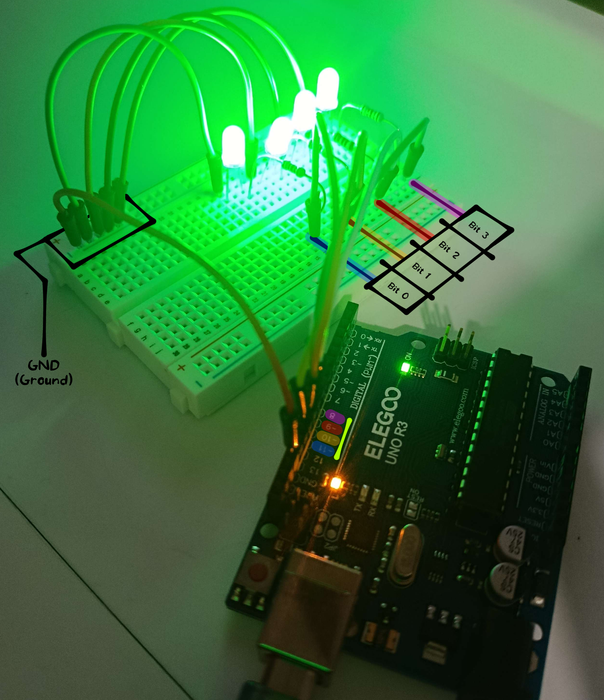
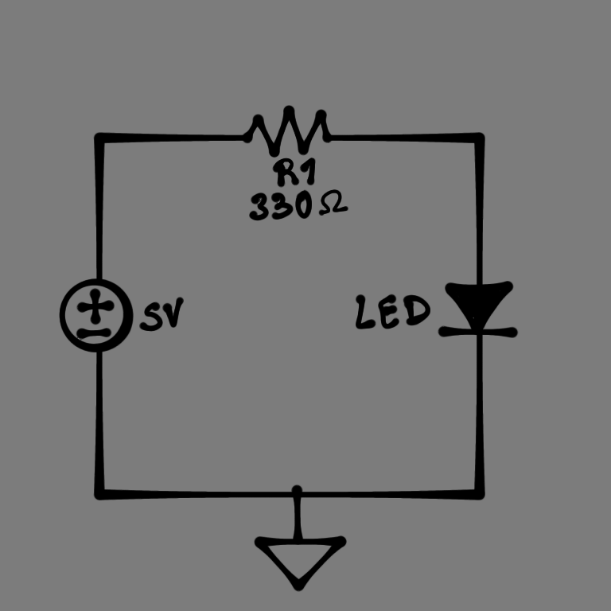
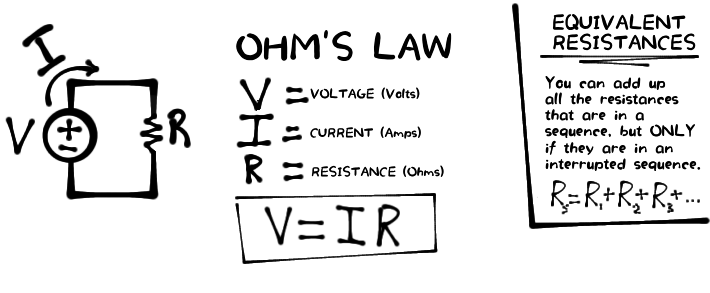
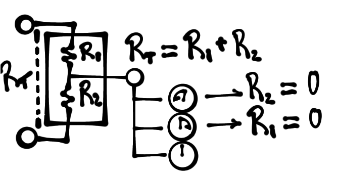
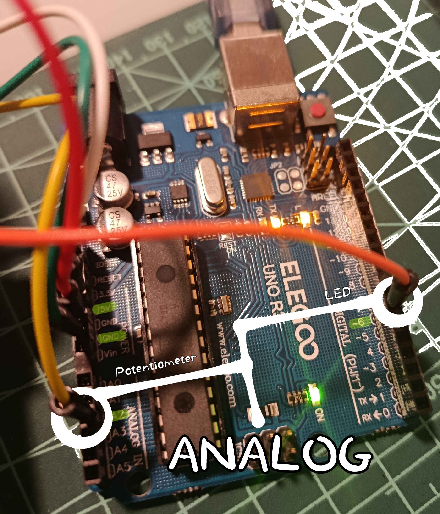
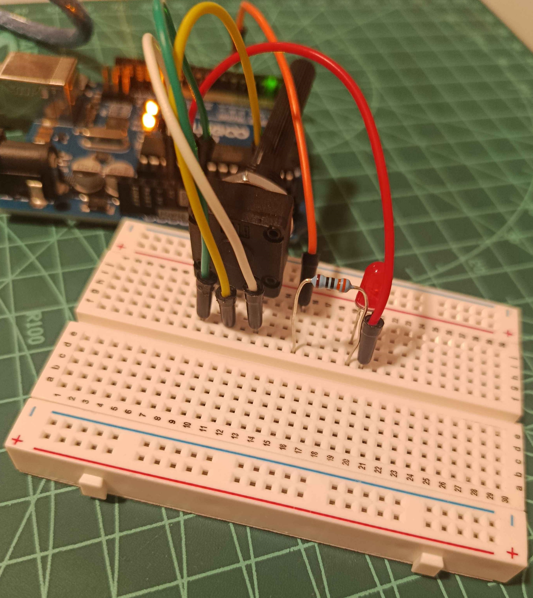
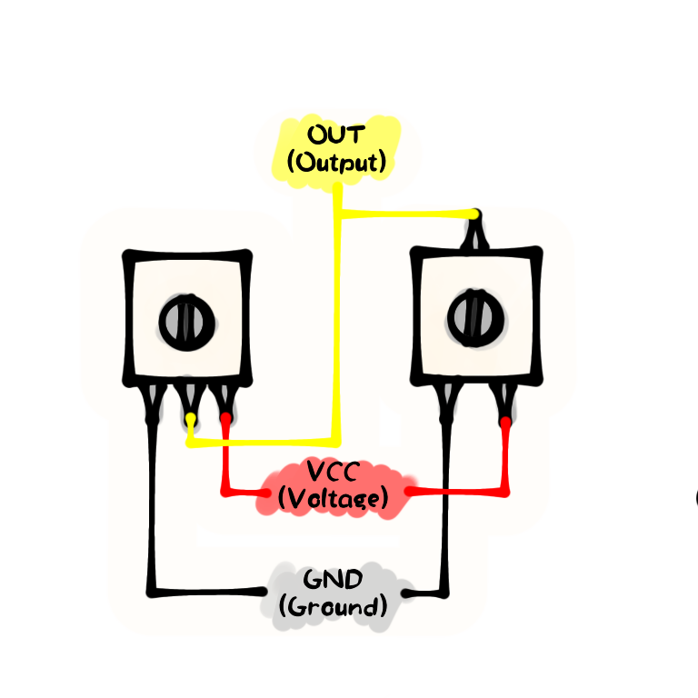
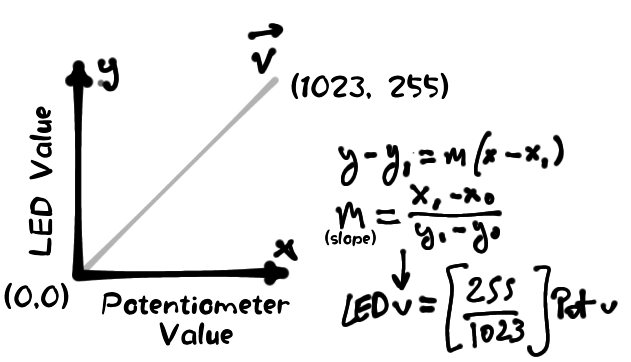

# Arduino Learning

## 1. Basics - Binary counter

Commit: _[Commit_No](https://github.com/ph0nsy/Arduino-Learning/tree/c3ec58170c44292dec32c15b78eebdbdbf204bd0)_

### 1.1. Summary

Taken advantage of binary numbers to make a counter for numbers from 0 to 15 — 4 bits, one per LED, representing 1 byte.

For example, number 11:

| Bit 3 | Bit 2 | Bit 1  | Bit 0  |
|:-----:|:-----:|:------:|:------:|
| Pin 8 | Pin 9 | Pin 10 | Pin 11 |
| HIGH  |  LOW  |  HIGH  |  HIGH  |

### 1.2. Implementation

||
|:---:|
||
| Picture for board set up. | 

||
|:---:|
||
| Diagram for simple _LED_ circuit. |

### 1.3. Learnt on this section

||
|:---:|
||
| Ohm's Law illustrated. | 

## 2. Potentiometers - Dimmable LED

### 2.1. Summary

Find the relationship between potentiometer value (0-1023) and LED value (0-255) to create a dimmable LED according to the potentiometer state (255/1023).

### 2.2 Implementation

||
|:---:|
||
| Potentiometer inner workings diagram. | 

|||
|:---:|:---:|
|||
| Arduino board circuit connections. | Real life circuit. | 

> 📑 **Note**
>
> While following Paul McWhorter's tutorials, I realized that my Arduino Kit didn't include a potentiometer — unlike his — so I had to buy one. The only affordable one I was able to find (courtesy of [Conectrol](https://conectrol.com/)) was a bit different than the one in the tutorials.
> This doesn't make anything different — neither for implementation nor for circuit design — but it may be confusing at first so, just in case you are in a similar situation:
> 

### 2.3. Learnt on this section

||
|:---:|
||
| Slope for potentiometer values. | 

## 3. A

## Special Thanks

- Paul McWhorter's [_New Arduino Tutorials_](https://www.youtube.com/playlist?list=PLGs0VKk2DiYw-L-RibttcvK-WBZm8WLEP) YouTube series.